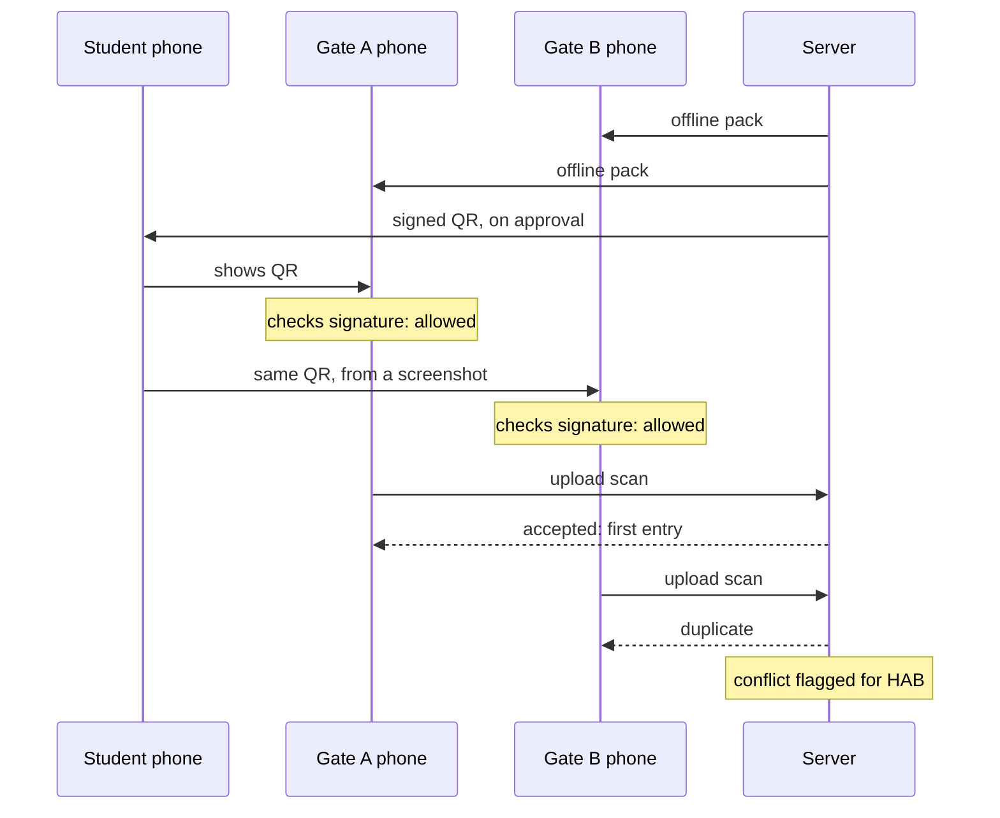

# Offline gate scanning: design and build plan

Status: proposed. Builds on the event registration and QR check-in feature (`server/v1/modules/event`).

## Goal and constraints

**Goal.** A volunteer at the gate can admit or refuse an attendee in under one second, even with no network. That covers a crowded auditorium, a basement, or the campus Wi-Fi going down during a fest. The server still ends up with an exact record of who entered, when, and through which gate.

**Why the current design breaks.** Today every scan calls `POST /events/:id/check-in`. The QR holds a random token that only the server can look up. With no network, the volunteer can't tell a real ticket from a fake one, so the queue stops.

**Constraints**

- **Correctness first.** A forged or edited QR must never be admitted, online or offline.
- **At most one entry per ticket is the target.** Offline gates can't talk to each other, so two gates *can* both admit the same ticket while offline. We accept that, detect it on sync, and show it to HAB. We don't pretend it can't happen.
- **No secrets on student or volunteer phones.** A phone can be lost or rooted, so anything stored on it must be safe to leak.
- **Backwards compatible.** Old app versions and existing `habit-event:<eventId>:<token>` QRs keep working online.
- **Small QR.** It must scan quickly off a cracked, dim phone screen, so aim for under about 200 characters.
- **Scale target.** A 5,000-person fest with 6 to 10 gates, and peaks of about 50 scans a second across all gates when doors open.

**Out of scope for v1:** NFC, printed tickets, and per-gate zones (VIP areas).

## Signed QR format

**Idea.** Instead of a random token that only the server can look up, the QR carries a small ticket that the server has *signed*. Any phone holding the server's public key can check the signature with no network. Changing a single byte of the ticket breaks the signature.

**Why Ed25519 and not HMAC.** HMAC uses one shared secret for both signing and checking, so every volunteer phone would hold a key that can *mint* tickets. Leaking that phone would let anyone forge entries. Ed25519 splits the keys: the private key never leaves the server, and the public key on phones can only *verify*. Ed25519 signatures are also small (64 bytes), fast to verify on a phone (well under 1 ms), and built into Node's `crypto` module, so the server needs no extra dependency.

**Ticket fields** (encode as a compact JSON array or CBOR, not a JSON object, to keep the QR short):

| Field | Meaning |
| --- | --- |
| `v` | Format version, starting at `2` (the current text QR is effectively v1) |
| `kid` | Id of the signing key, so keys can rotate |
| `e` | Event id |
| `r` | Registration id. This is the identity that check-ins are de-duplicated on |
| `u` | User id, so the volunteer's phone can show the right photo from the cached roster |
| `iat` | Issued-at time (seconds) |
| `nbf` / `exp` | Valid-from and valid-until. Default: from 2 hours before the event starts to the event's end |

Don't put the student's name or roll number in the QR. They would be readable by anyone who photographs it, and the cached roster already has them.

**QR string:** `habit2.<base64url(ticket)>.<base64url(signature)>`. The prefix lets the scanner tell old and new QRs apart. Rough size: about 60 bytes of ticket plus 64 of signature, which is around 170 characters after base64url. That fits comfortably in a QR at error-correction level M.

**Keys**

- One Ed25519 key pair per event, created when the event is created. Store the private key encrypted at rest (AES-GCM with a master key from an environment variable), never in plain text in Mongo.
- `kid` is a short random id. An event can hold several keys: the newest one signs, and all non-revoked ones verify.
- **Rotation:** HAB presses "Rotate signing key". A new key starts signing, the old one keeps verifying until the event ends, and students' QRs are re-issued the next time their app fetches the event. If a private key may have leaked, *revoke* it instead, and every ticket signed with it stops verifying once phones sync.

**Getting the public key to phones.** A new endpoint `GET /events/:id/offline-pack` (volunteers only) returns the event's public keys, the roster and the revocation list (see the next section). Volunteers download it while they still have network, before the gates open. The public key itself is not secret, but the roster is, which is why the endpoint is volunteer-only.

**Issuing.** When a registration is approved, the server signs a ticket and stores the QR string on the registration. The student's app shows it exactly as it shows the token today, and caches it so the QR also works when the *student* has no network.

## Offline verification on the volunteer's phone

**The offline pack** (from `GET /events/:id/offline-pack`, stored on the phone):

- `keys`: a list of `{kid, publicKey, revoked}`.
- `roster`: `{regId → {userId, name, rollNumber, hostel, photoUrl}}` for approved registrations. Download and cache the photos too, so the face check works offline.
- `revoked`: registration ids that were cancelled or rejected after their ticket was issued.
- `checkedIn`: registration ids the server already knows have entered, with times.
- `packVersion` and `generatedAt`, so the app can say "Offline data from 6:42 PM" and ask for a refresh when it is stale.

**Scan decision, in order.** Each step either refuses or moves to the next. Put this in a pure Dart function so it can be unit tested without a camera.

1. If the string starts with `habit-event:` (old format): online, call the server as today. Offline, refuse with "Old QR, needs network".
2. Parse `habit2.<ticket>.<sig>`. If it is malformed, refuse with **Invalid QR**.
3. Look up `kid` in `keys`. If it is unknown, refuse with "Unknown key, refresh offline data". If it is revoked, refuse with **Invalid QR**.
4. Verify the Ed25519 signature over the raw ticket bytes (not re-encoded JSON). If it fails, refuse with **Invalid QR**.
5. Check that `e` equals this event. If not, refuse with **Wrong event**.
6. Check `nbf ≤ now ≤ exp`, allowing 5 minutes of clock skew. If not, refuse with **Not valid now**.
7. If `r` is in `revoked`, refuse with **Registration cancelled**.
8. If `r` is in local check-ins or `checkedIn` from the pack, show **Already entered** with the time and gate.
9. Otherwise show **Entry allowed** with the roster photo and name, write the check-in to local storage *before* showing green, and add it to the upload queue.

**Local storage.** Use SQLite through `sqflite` or `drift`. Hive works too, but SQL makes the unique index and the queue simpler. Two tables:

- `local_checkins(regId PRIMARY KEY, scannedAt, deviceId, volunteerId, synced)`. The primary key on `regId` is what stops this phone admitting the same ticket twice.
- `offline_pack(eventId, json, packVersion, fetchedAt)`.

A crash or force-quit must never lose an admitted scan, so write first and then show the result.

**Dart libraries.** Use `cryptography` (pure Dart, has `Ed25519`) or `pinenacl`. Check that verification takes under 5 ms on a low-end Android phone. The rest of the scan decision is map lookups, so the whole thing should finish well under 50 ms after the camera decodes the QR.

**Online mode stays.** When the phone is online, still check offline first so the volunteer gets an instant answer, then send the check-in to the server right away. If the server answers **Already entered** for a scan that offline said was allowed, show a warning banner. That is the two-gate case described in the next section.

## Sync and conflict resolution

**Upload queue.** A background loop on the volunteer's phone takes rows where `synced = 0` and sends them in batches of up to 100 to a new endpoint: `POST /events/:id/check-ins/batch`. It runs whenever the phone is online: on every scan, every 15 seconds while the scanner is open, and when connectivity comes back (`connectivity_plus`). On failure it backs off exponentially (1s, 2s, 4s, up to 60s).

Each item is `{scanId, regId, scannedAt, deviceId}`. `scanId` is a UUID made on the phone when the scan happens. The volunteer is taken from the JWT, never from the request body.

**Idempotency.** Networks drop responses, so the phone will resend batches the server already processed. Store each `scanId` in a `ScanLog` collection with a unique index. A resent item hits the duplicate key, and the server answers with the same result it gave the first time. The phone marks rows synced only for items the server acknowledges.

**Server rules for each item**

1. Check that the registration belongs to this event and is approved. If not, record the scan as `invalid` (for example, the ticket was revoked while the gate was offline) and flag it for HAB.
2. Try the same conditional update used today: `findOneAndUpdate({_id: regId, checkedInAt: null}, {checkedInAt: scannedAt, checkedInBy, gate: deviceId})`.
3. If it matched, this is the **first entry**. Answer `accepted`.
4. If it did not match, the ticket was already used. Record a `conflict` with both scans (time, gate, volunteer) and answer `duplicate`, including the first scan's details.

**Who wins.** The first scan *the server records* becomes the official entry time, not the earliest `scannedAt`. Phone clocks can be wrong or deliberately changed, so the server shouldn't trust them for ordering. `scannedAt` is still stored and shown to HAB, but it's clamped to the range from `packFetchedAt` to the time of receipt.

**What a conflict means in practice.** Two offline gates both admitted the same ticket. Usually that means a student shared a screenshot of their QR with a friend. The system can't undo an entry, so its job is to detect it reliably and make it visible:

- The HAB event page gets a **Conflicts** tab listing each ticket with more than one scan: the student, each gate and time, and which volunteer scanned it.
- The dashboard shows counts: entered, conflicts, invalid scans.
- HAB decides what to do (warn the student, block future events). The code does not punish automatically.

**Keeping gates in step.** Each batch response also returns `checkedIn` changes since the phone's last sync (`?since=<cursor>`). That way a gate that comes back online learns within seconds about tickets used at other gates, which shrinks the window in which a duplicate can get through. This makes the design **eventually consistent**: while a gate is offline it can disagree with the others, but once it has synced it agrees with them.

**Revocations.** When HAB rejects a registration or a student cancels, add the id to the event's revocation list and bump `packVersion`. Phones fetch the change on their next sync, so tickets revoked while a gate is offline are caught as soon as it reconnects.

Both gates admit the screenshot because neither can see the other. The server accepts whichever upload arrives first and records the second as a conflict for HAB to review.

## Security edge cases

| Threat | What happens | Mitigation |
| --- | --- | --- |
| **Forged or edited QR** | Someone changes `r` or `e` in the ticket | The signature check fails, so the scan is refused online and offline. Test it by flipping one byte. |
| **Screenshot shared with a friend** | Both people try to enter | At a single gate, the local unique index catches the second scan. Across offline gates, both may get in, and the server flags it on sync. The volunteer must compare the roster photo with the face, which is the real defence. |
| **Replaying an old QR** at a later event | The ticket is reused | `e` must match this event, and `nbf`/`exp` limit the time window. |
| **Ticket revoked while gates are offline** | A rejected student tries to enter | The gate admits them until it syncs. The server marks the scan `invalid`, and HAB sees it. Tell HAB to finish approvals before doors open. |
| **Volunteer uploads fake check-ins** | A rogue volunteer marks friends as entered | The server only accepts uploads from volunteers of this event, and every check-in records the volunteer and device. That gives an audit trail but doesn't prevent it. |
| **Phone clock is wrong** | `nbf`/`exp` checks fail, or `scannedAt` is junk | Allow 5 minutes of skew. When the pack is downloaded, store the difference between server time and phone time, and use that corrected time. Never use `scannedAt` to decide which scan won. |
| **Leaked private key** | Anyone can mint valid tickets | Keys are per event, so the damage stays within one event. Revoke the `kid`, rotate, and re-issue QRs. Keep the master key only in an environment variable, never in the repo. |
| **Huge or garbage QR** | Crashes or slows the scanner | Reject strings over 512 characters before decoding, and wrap parsing in try/catch. |
| **Batch endpoint abuse** | Someone floods uploads | Limit batches to 100 items, rate limit per volunteer, and validate every id as an ObjectId. |

**What the design does *not* promise:** it doesn't guarantee exactly one entry when gates are offline. Promising that would require gates to coordinate, and that needs a network. The honest guarantee is that **no forged ticket is ever admitted, and every duplicate is detected and attributed**.

## Task breakdown

Build it as five PRs, each one mergeable on its own and reviewed before it goes upstream. Each milestone ends with tests that prove it works.

### M1. Server: keys and signed tickets

- New `server/v1/modules/event/ticketSigner.js` with `generateKeyPair()`, `encryptPrivateKey()`/`decryptPrivateKey()` (AES-256-GCM, master key from `EVENT_KEY_SECRET`), `signTicket(event, registration)` and `verifyTicket(qr, keys)`. Use only `node:crypto`.
- In `eventModel.js`, add `signingKeys: [{kid, publicKey, privateKeyEnc, createdAt, revokedAt}]`. Create a key in `createEvent`.
- In `eventRegistrationModel.js`, add `ticketV2` (the QR string). Set it wherever the token is issued today, in approve and in auto-approve.
- The student's `GET /events/:id` returns `ticketV2` next to the old QR.
- **Acceptance:** unit tests show a ticket round-trips, a one-byte flip fails, the wrong `kid` fails, an expired ticket fails, a revoked key fails, and the private key never appears in any API response (assert on the JSON).

### M2. Server: offline pack and batch check-in

- `GET /events/:id/offline-pack` (volunteers only) returns keys, roster, revoked ids, checked-in ids, `packVersion` and `serverTime`.
- `POST /events/:id/check-ins/batch` with the rules from the sync section. Add a `ScanLog` model with a unique `scanId`, and a `conflict` flag.
- Make the existing `POST /check-in` accept `habit2.` QRs as well, sharing the same code path.
- **Acceptance:** unit tests for idempotency (the same batch sent twice gives the same answer and writes nothing new), two gates uploading the same `regId` (one `accepted`, one `duplicate` plus a conflict), a revoked registration (`invalid`), and a volunteer from another event (403). Extend the e2e script to cover the same cases against real Mongo.

### M3. App: offline verification

- `lib/screens/events/offline/ticket_verifier.dart`: a pure function `verify(String qr, OfflinePack pack, DateTime now, Set<String> localCheckIns) → ScanDecision`.
- `offline_pack_store.dart` (download, cache, encrypt at rest) and `local_checkin_db.dart` (sqflite).
- On the event's Volunteer tab, add a **Download for offline** button, showing the pack's age and its size.
- The scanner uses the verifier first and shows an "Offline" chip when there's no network.
- **Acceptance:** Dart unit tests covering every branch of the scan decision, using test vectors produced by the Node signer, so both sides provably agree on the bytes. Verification takes under 5 ms (time 1,000 runs in a test).

### M4. App: sync queue

- `checkin_sync_service.dart`: batches, retries with backoff, resumes after restart, and runs on regained connectivity.
- A counter on the scanner shows "3 scans waiting to upload", and a banner reports duplicates the server returned.
- **Acceptance:** a test with a fake Dio adapter covers a dropped response, a retry, no double counting, and marking rows synced only after the server acknowledges them. Manual test: airplane mode, scan 5 tickets, force-quit, reopen, turn the network on, and all 5 appear on the dashboard.

### M5. Dashboard: conflicts

- `EventDetailPage.jsx` gets a **Conflicts** tab and an **Invalid scans** count, plus gate and device columns in the entry list.
- Add a "Rotate signing key" button next to the access code.
- **Acceptance:** with seeded conflicts, the tab lists both scans with their gates, times and volunteers.

### Order and size

M1 and M2 are pure server work and can be tested without a phone. M3 is the hardest, because getting Dart and Node to agree on the signature bytes is the classic trap; that's why the shared test vectors matter. M4 and M5 are smaller.

**Review checklist for each PR:** tests for the failure paths, not just the happy path; no secrets in responses or logs; every write is idempotent; and the behaviour stays the same for old app versions.

## Load testing and real deployment

### Load test with k6

**Setup.** Run the API and MongoDB on a machine close to production (for example, a 2 vCPU VM with a Mongo replica set). Run k6 from a *different* machine, so the load generator doesn't compete with the server for CPU. Seed one event with 5,000 approved registrations and 10 volunteers, and write their QRs and JWTs to a JSON file that k6 reads.

**Scenarios** (`server/loadtest/*.js`, one file each):

1. **Door rush, online.** 10 virtual volunteers, ramping to a combined 50 check-ins a second for 3 minutes, with 5% duplicate scans mixed in. This measures today's `POST /check-in`.
2. **Registration rush.** 2,000 students hitting `POST /register` within 60 seconds on an event with 500 seats. It checks two things: speed, and that exactly 500 get approved.
3. **Reconnect storm.** 10 gates each come back online holding 500 queued scans and upload them in batches of 100 at once. This measures the batch endpoint and conflict detection.
4. **Soak.** 20 check-ins a second for 30 minutes, to catch memory leaks and a growing connection pool.

**Record for each scenario:** p50, p95 and p99 latency, error rate, throughput, Mongo CPU, and the slowest queries (`db.setProfilingLevel(1, {slowms: 20})`).

**Pass criteria:** door rush p99 under 300 ms with 0 errors. Registration rush has exactly 500 approved, every time, over 5 runs. Reconnect storm finishes within 30 seconds with every duplicate flagged.

**Before and after.** Run the scenarios once on the current code and save the numbers. Then fix what the profiler shows. Likely candidates: a missing compound index on `{event, qrToken}` or `{event, status}`, populating user data on every scan, and the Mongo connection pool size. Run again and compare.

### Real deployment

1. **Pick one real event.** A hostel night, a club workshop, or a small fest. 100 to 300 attendees is plenty for a first run.
2. **Dry run the day before.** Two volunteer phones, airplane mode, 20 test tickets. Include a screenshot duplicate and a revoked ticket on purpose.
3. **On the day:** keep a paper list at the gate as a fallback, and write down every problem as it happens.
4. **Afterwards, collect:**
   - Attendees registered, entered, and the no-show rate.
   - Median time per scan at the gate.
   - How many scans happened offline, and how long the longest offline stretch was.
   - Duplicates and conflicts caught.
   - Crashes (add Sentry or Firebase Crashlytics before the event).
5. **Write a short post-mortem:** what broke and what changed.
